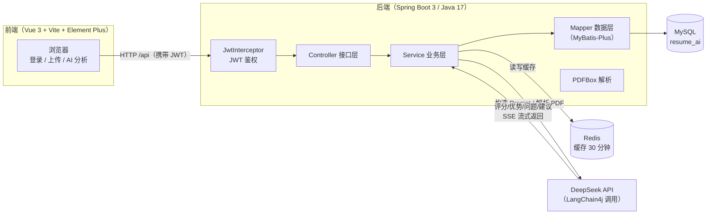

# AI Resume Copilot — 智能简历分析助手

> 上传一份 PDF 简历，让 AI 帮你做一次「模拟面试官」式的打分与优化。

这是一个前后端分离的简历分析项目：用户上传 PDF 简历，后端用 **PDFBox** 解析文本，通过 **LangChain4j** 调用 **DeepSeek** 大模型，输出**评分 / 优势 / 问题 / 优化建议**，并支持 **SSE 流式输出**（像 ChatGPT 一样逐字展示），结果自动存入 MySQL 并用 Redis 缓存。

---

## 目录

- [它解决了什么问题](#它解决了什么问题)
- [功能特性](#功能特性)
- [技术栈](#技术栈)
- [目录结构](#目录结构)
- [环境要求](#环境要求)
- [快速开始](#快速开始)
  - [1. 初始化数据库](#1-初始化数据库)
  - [2. 启动 Redis](#2-启动-redis)
  - [3. 配置（数据库 / Redis / API Key）](#3-配置数据库--redis--api-key)
  - [4. 启动后端](#4-启动后端)
  - [5. 启动前端](#5-启动前端)
- [使用步骤（从登录到完成一次分析）](#使用步骤从登录到完成一次分析)
- [架构图](#架构图)
- [页面截图](#页面截图)
- [API 接口一览](#api-接口一览)
- [已知限制](#已知限制)

---

## 它解决了什么问题

求职者投简历前，往往不知道自己的简历在面试官眼里是什么水平、有哪些硬伤。这个项目把「人工改简历」变成「AI 快速诊断」：

- 上传 PDF 简历，自动解析出文字内容；
- AI 以「资深面试官」角色对简历打分（0–100），并给出**优势、问题、优化建议**；
- 分析过程**流式实时输出**，不用干等十几秒；
- 结果落库，随时回看历史分析记录。

## 功能特性

| 功能 | 说明 |
|------|------|
| 用户注册 / 登录 | 密码 BCrypt 加密，登录签发 JWT（24h 有效），无状态鉴权 |
| 上传 PDF 简历 | PDFBox 解析文本，自动入库（文件名 + 内容） |
| 简历管理 | 列表、查看、编辑、删除（带用户归属校验） |
| AI 分析 | DeepSeek 输出评分 / 优势 / 问题 / 优化建议（结构化 JSON） |
| 流式输出 | SSE 逐 token 展示，失败自动降级为非流式请求 |
| 结果缓存 | Redis 缓存分析结果 30 分钟，重复分析不重复扣费 |
| 分析记录 | 历史分析结果列表，可一键重新分析 |

## 技术栈

### 后端

| 技术 | 版本 | 用途 |
|------|------|------|
| Spring Boot | 3.4.5 | Web 框架，内嵌 Tomcat |
| Java | 17 | 运行环境 |
| MyBatis-Plus | 3.5.7 | ORM，`BaseMapper` 通用 CRUD + Lambda 条件构造器 |
| MySQL | 8.x | 数据存储（驱动 `mysql-connector-j`） |
| Redis | 6+ | 分析结果缓存 |
| LangChain4j | 0.36.2 | 声明式 AI 调用（`ChatLanguageModel` + 流式双模型） |
| DeepSeek | deepseek-chat | 大模型（OpenAI 兼容 API） |
| PDFBox | 3.0.3 | PDF 文本解析 |
| jjwt | 0.11.2 | JWT 签发与校验（HMAC-SHA256） |
| spring-security-crypto | — | BCrypt 密码加密（仅加密模块，未引入整套 Security） |

### 前端

| 技术 | 版本 | 用途 |
|------|------|------|
| Vue | 3.5 | 框架（Composition API / `<script setup>`） |
| Vite | 8.2 | 构建工具 + 开发服务器 |
| Element Plus | 2.14 | UI 组件库 |
| Vue Router | 4.6 | 路由 + 鉴权守卫 |
| Axios | 1.19 | HTTP 请求 + 拦截器（统一处理 JWT 与业务错误） |

## 目录结构

```
ai-resume-copilot/
├── pom.xml                    # 后端 Maven 配置（Spring Boot 3.4.5 / Java 17）
├── src/main/java/com/gyx/
│   ├── AiResumeCopilotApplication.java   # 启动类
│   ├── controller/            # 接口层（User / Resume / AI / File）
│   ├── service/               # 业务层（接口 + impl 实现）
│   ├── mapper/                # MyBatis-Plus 数据层
│   ├── entity/ dto/ vo/       # 实体 / 入参 / 出参
│   ├── ai/                    # LangChain4j 声明式接口 + Prompt 构造
│   ├── rag/                   # RAG 检索增强模块（独立，未接入主流程）
│   ├── config/                # AI / Redis / Web / 静态资源配置
│   ├── interceptor/           # JWT 拦截器
│   ├── exception/             # 全局异常处理
│   └── utils/                 # JwtUtil / PdfUtil / FileUtil 等
├── src/main/resources/
│   └── application.yml        # 后端配置（数据库 / Redis / AI Key）
├── docs/
│   ├── init.sql               # 建库建表脚本
│   └── project-overview.md    # 面试讲解版项目说明
└── resume-frontend/           # 前端工程（Vue 3 + Vite）
    └── src/
        ├── api/               # Axios 实例 + 所有 API 封装
        ├── router/            # 路由 + beforeEach 鉴权守卫
        ├── stores/            # 登录态管理
        └── views/             # Login / Register / Dashboard
```

## 环境要求

| 软件 | 版本要求 | 说明 |
|------|---------|------|
| JDK | 17 及以上 | 后端编译运行 |
| Maven | 3.6+ | 后端构建（项目自带 `mvnw` 包装器，可免安装） |
| Node.js | 20.19+ 或 22.12+ | 前端 Vite 8 要求（推荐 22 LTS） |
| MySQL | 5.7 / 8.x | 数据库 |
| Redis | 6+ | 缓存（可选，见「已知限制」） |
| DeepSeek API Key | — | 在 [platform.deepseek.com](https://platform.deepseek.com) 申请 |

## 快速开始

### 1. 初始化数据库

先确保本机 MySQL 已启动，然后执行 `docs/init.sql`：

```bash
mysql -u root -p < docs/init.sql
```

或在 Navicat / DataGrip 等客户端中直接运行该脚本。脚本会：

1. 创建数据库 `resume_ai`（utf8mb4）；
2. 创建 4 张表：`sys_user`（用户）、`resume_record`（简历）、`ai_analysis_record`（分析记录）、`resume_analysis`（结果汇总）。

### 2. 启动 Redis

- **Windows**：启动本机安装的 Redis 服务，或用 Docker：
  ```bash
  docker run -d --name redis -p 6379:6379 redis:7
  ```
- **macOS / Linux**：`redis-server` 或 `docker run ...` 同上。

默认连接 `localhost:6379`（无密码），与 `application.yml` 一致。

### 3. 配置（数据库 / Redis / API Key）

项目根目录的 `application-local.yml` 用于存放本机配置。该文件已加入 `.gitignore`，不会随 Git 提交；`src/main/resources/application.yml` 会在启动时自动导入它。

首次运行时，在项目根目录创建 `application-local.yml`，示例：

```yaml
spring:
  datasource:
    username: root
    password: "你的 MySQL 密码"

langchain4j:
  open-ai:
    chat-model:
      api-key: "你的 DeepSeek API Key"
```

把引号中的说明换成自己的值。不要把真实密钥写进 `src/main/resources/application.yml`，也不要提交 `application-local.yml`。如果使用 IDEA 启动，确认运行配置的 **Working directory** 是项目根目录（包含 `pom.xml` 的目录）。

也可以使用环境变量覆盖配置：`DB_URL`（默认 `jdbc:mysql://localhost:3306/resume_ai`）、`DB_USERNAME`（默认 `root`）、`DB_PASSWORD`、`AI_API_KEY` 和 `JWT_SECRET`。在 PowerShell 中设置的 `$env:...` 只对该窗口启动的程序生效；从 IDEA 启动时，应将变量填入 IDEA 的运行配置，或使用上述本地配置文件。

### 4. 启动后端

在项目根目录执行：

```bash
# Windows
mvnw.cmd spring-boot:run

# macOS / Linux（或已安装 Maven 时）
./mvnw spring-boot:run
# 或
mvn spring-boot:run
```

启动成功后默认监听 **8080** 端口。看到 `Started AiResumeCopilotApplication` 即表示成功。

### 5. 启动前端

新开一个终端：

```bash
cd resume-frontend
npm install
npm run dev
```

访问 **http://localhost:5173**。前端已配置代理，`/api` 请求会自动转发到 `http://localhost:8080`，无需额外处理跨域。

## 使用步骤（从登录到完成一次分析）

1. **注册**：打开 http://localhost:5173，自动跳到登录页，点「立即注册」。用户名 3–20 位、密码 6–32 位（邮箱可选）。
2. **登录**：用刚注册的账号登录，成功后进入工作台（Dashboard）。
3. **上传简历**：左侧「上传简历」→ 拖拽或点击选择一份 **PDF** 简历，系统自动用 PDFBox 解析内容。
4. **查看列表**：切到「简历列表」，能看到刚上传的简历（可查看 / 编辑 / 删除）。
5. **发起分析**：点某条简历的「分析」按钮（或切到「AI 分析」选择简历后点「开始 AI 分析」）。
6. **等待结果**：页面会**流式逐字输出** AI 的分析过程；完成后展示「评分（/100）＋优势 + 问题 + 优化建议」。
7. **回看记录**：切到「分析记录」可看到所有已分析的简历，支持一键重新分析。

> 如果网络或 SSE 失败，前端会自动降级为非流式请求，保证分析不中断。

## 架构图



> 静态图片版本见 [`docs/images/architecture.svg`](docs/images/architecture.svg)，可插入幻灯片或文档。

## 页面截图

> 以下为占位，运行项目后请替换为实际截图（放入 `docs/images/` 下对应文件名）。

| 页面 | 截图 |
|------|------|
| 登录页 |  |
| 注册页 |  |
| 上传简历 |  |
| 简历列表 |  |
| AI 分析结果 |  |

## API 接口一览

所有接口统一返回 `{ code, message, data }`，`code === 200` 表示成功。

| 方法 | 路径 | 说明 | 鉴权 |
|------|------|------|------|
| POST | `/api/user/register` | 注册 | 否 |
| POST | `/api/user/login` | 登录，返回 JWT | 否 |
| POST | `/api/resume/upload` | 上传 PDF（表单字段 `file`），解析并入库 | 是 |
| GET | `/api/resume/list` | 当前用户简历列表 | 是 |
| GET | `/api/resume/{id}` | 简历详情 | 是 |
| POST | `/api/resume/save` | 保存简历 | 是 |
| PUT | `/api/resume/{id}` | 更新简历 | 是 |
| DELETE | `/api/resume/{id}` | 删除简历 | 是 |
| POST | `/api/ai/analyze` | 非流式 AI 分析（JSON：`{"resumeId":1}`） | 是 |
| POST | `/api/ai/analyze/stream` | 流式 AI 分析（SSE） | 是 |
| POST | `/api/file/upload` | 通用文件上传（返回访问 URL） | 是 |

## 已知限制

- **AI 分析需要有效 Key**：DeepSeek Key 缺失、失效或余额不足时，分析会失败并报错。务必先配置 `AI_API_KEY`。
- **仅支持 PDF**：后端用 PDFBox 解析，前端也限制了 `.pdf`。上传其他格式会提示「简历上传失败」。
- **简历上传限制**：只接受 PDF，文件大小上限为 10 MB。系统会检查文件名后缀和 PDF 文件签名；没有可提取文字的扫描版 PDF 暂不支持。
- **简历只存文本**：上传时仅解析并保存 PDF 的文字内容（`fileName` + `content`），原始 PDF 文件不落盘。`file.upload-path` 是给通用文件上传接口 `/api/file/upload` 用的。
- **上传路径是 Windows 绝对路径**：`file.upload-path` 默认 `D:/data/resume-upload/`，在 macOS / Linux 上需修改（或仅在你用到 `/api/file/upload` 时受影响）。
- **Redis 可降级**：代码对 Redis 访问做了兜底，未启动 Redis 时 AI 分析仍可运行，只是缓存失效。建议正常启动。
- **RAG 模块未接入主流程**：`rag/` 目录下的检索增强实现为独立模块，当前主分析流程（`AiServiceImpl`）未调用，仅作扩展预留。
